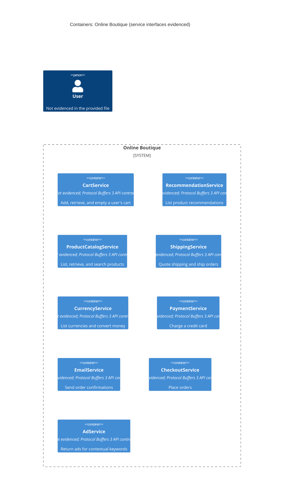

# Recovered architecture

## Agent

AI assistant using Copilot SDK in VS Code; model not known.

## Files read

- `prompts/1-recover-architecture.md`
- `system/online-boutique/protos/demo.proto`

## Containers table

The file declares these logical service interfaces. It does not establish that each is deployed as a separate container, nor identify its implementation technology.

| Name | Technology/language | Responsibility | Evidence |
|---|---|---|---|
| CartService | Implementation not evidenced; Protocol Buffers 3 API contract | Add, retrieve, and empty a user's cart | `system/online-boutique/protos/demo.proto` (`CartService`) |
| RecommendationService | Implementation not evidenced; Protocol Buffers 3 API contract | List recommendations using a user ID and product IDs | `system/online-boutique/protos/demo.proto` (`RecommendationService`) |
| ProductCatalogService | Implementation not evidenced; Protocol Buffers 3 API contract | List, retrieve, and search products | `system/online-boutique/protos/demo.proto` (`ProductCatalogService`) |
| ShippingService | Implementation not evidenced; Protocol Buffers 3 API contract | Get a shipping quote and ship an order | `system/online-boutique/protos/demo.proto` (`ShippingService`) |
| CurrencyService | Implementation not evidenced; Protocol Buffers 3 API contract | List supported currencies and convert money | `system/online-boutique/protos/demo.proto` (`CurrencyService`) |
| PaymentService | Implementation not evidenced; Protocol Buffers 3 API contract | Charge a credit card for an amount | `system/online-boutique/protos/demo.proto` (`PaymentService`) |
| EmailService | Implementation not evidenced; Protocol Buffers 3 API contract | Send an order confirmation to an email address | `system/online-boutique/protos/demo.proto` (`EmailService`) |
| CheckoutService | Implementation not evidenced; Protocol Buffers 3 API contract | Place an order | `system/online-boutique/protos/demo.proto` (`CheckoutService`) |
| AdService | Implementation not evidenced; Protocol Buffers 3 API contract | Return ads for contextual keywords | `system/online-boutique/protos/demo.proto` (`AdService`) |

## Dependencies table

No runtime caller-to-callee dependencies or transport protocols are established by this file. The RPC declarations define service operations but do not identify which service calls another.

| Caller → callee | Protocol | Evidence |
|---|---|---|
| Not evidenced in the provided file | Not evidenced in the provided file | `system/online-boutique/protos/demo.proto` declares RPC methods but no callers or transport configuration |

## Mermaid diagram

## Gaps

- Whether these service interfaces correspond to deployed containers, and their implementation languages: deployment manifests and service source/build files would settle this.
- Runtime dependencies and protocols: service implementation call sites or deployment configuration would identify callers, callees, and transport.
- Data stores and external systems: service implementations and deployment configuration are not present in the provided evidence.
- Users or other callers of the system: frontend/API entry-point code or deployment configuration would identify them.
