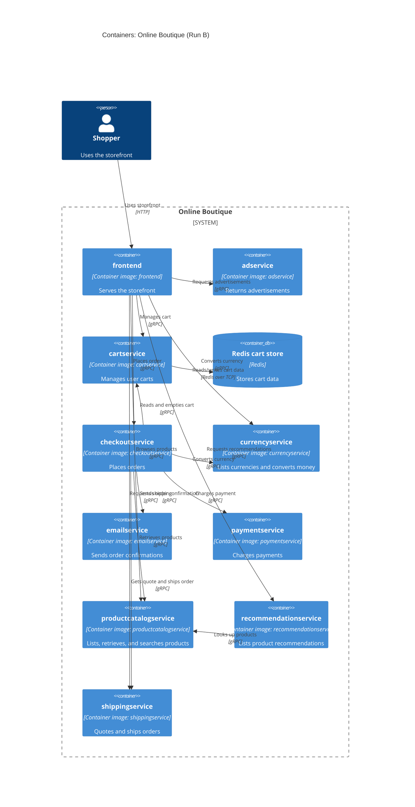

# Recovered architecture — Run B

## Agent

Copilot SDK in VS Code; model not known.

## Files read

- `AGENTS.md`
- `prompts/1-recover-architecture.md`
- Evidence:
  - `system/online-boutique/protos/demo.proto`
  - `system/online-boutique/kubernetes-manifests/README.md`
  - `system/online-boutique/kubernetes-manifests/adservice.yaml`
  - `system/online-boutique/kubernetes-manifests/cartservice.yaml`
  - `system/online-boutique/kubernetes-manifests/checkoutservice.yaml`
  - `system/online-boutique/kubernetes-manifests/currencyservice.yaml`
  - `system/online-boutique/kubernetes-manifests/emailservice.yaml`
  - `system/online-boutique/kubernetes-manifests/frontend.yaml`
  - `system/online-boutique/kubernetes-manifests/loadgenerator.yaml`
  - `system/online-boutique/kubernetes-manifests/paymentservice.yaml`
  - `system/online-boutique/kubernetes-manifests/productcatalogservice.yaml`
  - `system/online-boutique/kubernetes-manifests/recommendationservice.yaml`
  - `system/online-boutique/kubernetes-manifests/shippingservice.yaml`
  - `system/online-boutique/kubernetes-manifests/kustomization.yaml`

## Containers table

| Name | Technology/language | Responsibility | Evidence |
|---|---|---|---|
| frontend | Container image `frontend`; implementation language not evidenced | Serves the storefront over HTTP and connects the UI to catalog, currency, cart, recommendations, shipping, checkout, ads, and a configured shopping-assistant endpoint. | `frontend.yaml` (`image`, port 80/8080 and `*_SERVICE_ADDR` variables) |
| adservice | Container image `adservice`; implementation language not evidenced | Returns advertisements through `AdService.GetAds`. | `adservice.yaml` (`image`); `demo.proto` (`AdService`) |
| cartservice | Container image `cartservice`; implementation language not evidenced | Adds, retrieves, and empties user carts through `CartService`. | `cartservice.yaml` (`image`); `demo.proto` (`CartService`) |
| Redis cart store | Redis (`redis:alpine`) | Stores cart data for cartservice; a Redis endpoint is configured for the service. | `cartservice.yaml` (`redis-cart` Deployment/Service and `REDIS_ADDR`) |
| checkoutservice | Container image `checkoutservice`; implementation language not evidenced | Places orders through `CheckoutService.PlaceOrder`. | `checkoutservice.yaml` (`image`); `demo.proto` (`CheckoutService`) |
| currencyservice | Container image `currencyservice`; implementation language not evidenced | Lists supported currencies and converts money through `CurrencyService`. | `currencyservice.yaml` (`image`); `demo.proto` (`CurrencyService`) |
| emailservice | Container image `emailservice`; implementation language not evidenced | Sends order confirmations through `EmailService.SendOrderConfirmation`. | `emailservice.yaml` (`image`); `demo.proto` (`EmailService`) |
| paymentservice | Container image `paymentservice`; implementation language not evidenced | Charges a payment through `PaymentService.Charge`. | `paymentservice.yaml` (`image`); `demo.proto` (`PaymentService`) |
| productcatalogservice | Container image `productcatalogservice`; implementation language not evidenced | Lists, retrieves, and searches products through `ProductCatalogService`. | `productcatalogservice.yaml` (`image`); `demo.proto` (`ProductCatalogService`) |
| recommendationservice | Container image `recommendationservice`; implementation language not evidenced | Lists product recommendations through `RecommendationService`. | `recommendationservice.yaml` (`image`); `demo.proto` (`RecommendationService`) |
| shippingservice | Container image `shippingservice`; implementation language not evidenced | Provides shipping quotes and ships orders through `ShippingService`. | `shippingservice.yaml` (`image`); `demo.proto` (`ShippingService`) |

## Dependencies table

| Caller → callee | Protocol | Evidence |
|---|---|---|
| Shopper → frontend | HTTP | `frontend.yaml` (`frontend-external` Service, port named `http`, port 80) |
| frontend → adservice | gRPC | `frontend.yaml` (`AD_SERVICE_ADDR`); `adservice.yaml` (Service port named `grpc`); `demo.proto` (`AdService`) |
| frontend → cartservice | gRPC | `frontend.yaml` (`CART_SERVICE_ADDR`); `cartservice.yaml` (Service port named `grpc`); `demo.proto` (`CartService`) |
| frontend → checkoutservice | gRPC | `frontend.yaml` (`CHECKOUT_SERVICE_ADDR`); `checkoutservice.yaml` (Service port named `grpc`); `demo.proto` (`CheckoutService`) |
| frontend → currencyservice | gRPC | `frontend.yaml` (`CURRENCY_SERVICE_ADDR`); `currencyservice.yaml` (Service port named `grpc`); `demo.proto` (`CurrencyService`) |
| frontend → productcatalogservice | gRPC | `frontend.yaml` (`PRODUCT_CATALOG_SERVICE_ADDR`); `productcatalogservice.yaml` (Service port named `grpc`); `demo.proto` (`ProductCatalogService`) |
| frontend → recommendationservice | gRPC | `frontend.yaml` (`RECOMMENDATION_SERVICE_ADDR`); `recommendationservice.yaml` (Service port named `grpc`); `demo.proto` (`RecommendationService`) |
| frontend → shippingservice | gRPC | `frontend.yaml` (`SHIPPING_SERVICE_ADDR`); `shippingservice.yaml` (Service port named `grpc`); `demo.proto` (`ShippingService`) |
| checkoutservice → cartservice | gRPC | `checkoutservice.yaml` (`CART_SERVICE_ADDR`); `cartservice.yaml` (Service port named `grpc`); `demo.proto` (`CartService`) |
| checkoutservice → currencyservice | gRPC | `checkoutservice.yaml` (`CURRENCY_SERVICE_ADDR`); `currencyservice.yaml` (Service port named `grpc`); `demo.proto` (`CurrencyService`) |
| checkoutservice → emailservice | gRPC | `checkoutservice.yaml` (`EMAIL_SERVICE_ADDR`); `emailservice.yaml` (Service port named `grpc`); `demo.proto` (`EmailService`) |
| checkoutservice → paymentservice | gRPC | `checkoutservice.yaml` (`PAYMENT_SERVICE_ADDR`); `paymentservice.yaml` (Service port named `grpc`); `demo.proto` (`PaymentService`) |
| checkoutservice → productcatalogservice | gRPC | `checkoutservice.yaml` (`PRODUCT_CATALOG_SERVICE_ADDR`); `productcatalogservice.yaml` (Service port named `grpc`); `demo.proto` (`ProductCatalogService`) |
| checkoutservice → shippingservice | gRPC | `checkoutservice.yaml` (`SHIPPING_SERVICE_ADDR`); `shippingservice.yaml` (Service port named `grpc`); `demo.proto` (`ShippingService`) |
| recommendationservice → productcatalogservice | gRPC | `recommendationservice.yaml` (`PRODUCT_CATALOG_SERVICE_ADDR`); `productcatalogservice.yaml` (Service port named `grpc`); `demo.proto` (`ProductCatalogService`) |
| cartservice → Redis cart store | Redis over TCP | `cartservice.yaml` (`REDIS_ADDR`; Redis Service port named `tcp-redis`) |

## Mermaid diagram

## Gaps

- The implementation languages of the application containers are not evidenced in the supplied files; the manifests identify image names, while `demo.proto` defines service interfaces.
- `frontend.yaml` configures `SHOPPING_ASSISTANT_SERVICE_ADDR=shoppingassistantservice:80`, but the supplied files do not define that service or establish its protocol. It is therefore not included as a container or dependency.
- `loadgenerator.yaml` describes a load-generator deployment that targets `frontend:80`, but `kustomization.yaml` comments out `loadgenerator.yaml` as a resource. Its inclusion in the active architecture is not evidenced. `kustomization.yaml` notes it is used through the Skaffold development module.
- No human-user workflow beyond access to the HTTP frontend is evidenced; the Shopper relation represents that entry point.
